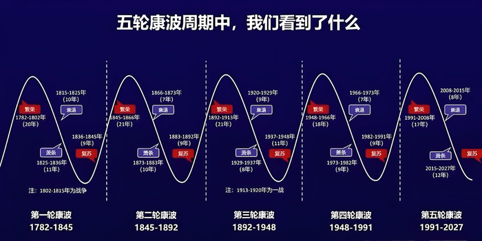

2026 年 11 月中，股票在跌，黄金在大跌，比特币和房产也在跌。按第五波康波，这一段处在萧条的中后段。

AI 在加快这一轮的衰老。工业革命里，个人效率低，公司把人收进来，靠架构和分工把组织做快。AI 提高的是个人能完成的任务。公司正在缩小招聘入口，也在精简组织。裁员已经在发生。再往下，更多产出会落到个人身上，人会更接近超级个体。普通人在这个环境里怎么撑过去？

#### 康波周期

康波周期是经济学里的一种长周期，也叫康德拉季耶夫周期，大约 50 到 60 年一轮。 
一轮里面依次是<b>繁荣</b> -> <b>衰退</b> -> <b>萧条</b> -> <b>复苏</b>，下一轮再走这四段。 
简单的这个理论的意思就是说每一轮都由技术变革推动，而循环一个周期。现在正好处在第五轮的后段。已经走过的主导技术是：

1. 纺织和蒸汽时代
2. 铁路与钢铁时代
3. 电气与化工、汽车和电子
4. 信息技术与计算机时代

图：五轮康波周期。来源：[《康波周期回升要来了？未来 3 到 5 年，全球财富或迎来新一轮大洗牌》](https://cj.sina.com.cn/articles/view/5969845199/163d49bcf00101825q)，新浪财经，2026-11-09。

每一轮都会带来新的财富变更与积累，年份间隔可以差五到七年。

国内经济学家，周金涛曾经把 2016 年到 2025 年这段时间看作是第五轮的周期，比这张图早两年。他把 2030 年附近同时看成商品产能周期的低点、康波回升、技术股权最值得持有的时候。他标过的 2019 年全球资产价格低点没有出现，美国股市在那之后多次创新高。2025 年过完，价格还在高波动，地产投资和开工还在收缩。诚通证券 2026 年 8 月把萧条终点放在 2028 到 2031 年，前提是从 2020 年前后起算，比图上的 2027 年再晚一段，三个说法终点不在同一年，现在也不好预测确切的时间点，只能随时准备着。

#### AI 加速了第五波的衰落

但是如果，要确认第六波已经开始，得看三个信号。

1. 年轻岗位的入口有没有重新打开， 意思是有没有下一个波的新岗位有没有冒出来，包括新出现的 AI 岗位。
2. 公司交出去的成果有没有因为新技术变多，公司企业因为下一个周期的技术开始营利。
3. 全经济的生产率开始升高，比以前科技革命的还要高。

三个信号一起变，才算新一轮繁荣开始。2026 年 11 月只对上了第一个。

第五波的主导技术是信息技术。AI 长在芯片、网络、软件和数据上，先动的是任务速度。美联储副主席杰斐逊 11 月 13 日引用的从业者调查里，四成到五成在职成年人在工作中使用生成式 AI，每天使用的只是其中一小部分。美国人口普查局的企业调查显示，2026 年年中大约 25% 的美国企业至少在一项职能里用上了它。专业服务和信息业接近 40%，采矿、休闲和酒店大约 10%。Yotzov 等人 2026 年 10 月修订的调查按员工加权，采用率到 95%，因为大公司雇了大多数人。同一份调查估计，过去三年 AI 把人均销售额抬高了大约 0.5%。

公司交出去的东西没有跟着任务速度同比例增加。杰斐逊还提到，有公司反映 AI 写的代码错误更多，调试的工作跟着上来。

收紧的是新人进入的门。斯坦福数字经济实验室的 Brynjolfsson、Chandar、Chen 用 ADP 工资单追到 2026 年 6 月。全经济没有出现普遍的岗位消失。22 到 25 岁里，AI 暴露最高的两组职业，就业比跟上暴露最低三组同龄人的路径低 19%。这组人自己的就业从 2022 年 11 月到 2026 年 6 月大约少了 11%，低暴露的同龄人大约多了 10%。2025 年 7 月那一版数据里，这个缺口是 15%。少掉的主要是招聘。已经在职的人，离职没有同比例增加。论文写明这是描述，不是因果估计。暴露高和暴露低的职业，在 ChatGPT 之前已经有一些分化。去掉计算机职业之后，方向还在。这组差距在 ADP 样本里比全国调查更大。

裁员公告对得上这个判断。Challenger, Gray & Christmas 11 月 5 日统计，10 月美国企业宣布裁员 43,994 人，比 2025 年 10 月少 71%。1 到 10 月累计 617,189 人，比去年同期少 44%。杰斐逊说，10 月美国失业率 4.1%，裁员仍低。点名 AI 的裁员，1 到 10 月有 121,401 人，大约占全部宣布裁员的两成。10 月只剩 1,265 人，是今年单月最低。企业自己写出的第一原因已经换成市场和经济状况，今年累计 130,531 人。科技业仍是今年裁得最多的行业，1 到 10 月 171,501 人，比去年同期多 21%，占全部宣布裁员的 28%，已经超过 2025 年全年的 154,445 人。10 月微软向约 6 万名员工提出自愿离职，Challenger 没有把尚未接受的名额算进当月裁员。这些是公司写在公告里的人数和理由。公告里的 AI 是公司自己选的说法，不是被替换岗位的统计。

总量仍被资本开支托着。Wachter 与 Wachter 在 2026 年 10 月用披露估算，Amazon、Alphabet、Microsoft、Meta、Oracle 五家的资本开支，2026 年预测 7,840 亿美元，大约是美国名义 GDP 的 2.5%。2027 年估算 1.09 万亿美元，大约 3.3%。资本开支按全球合并，GDP 只算美国，这个比例会把美国份额说高。2027 年的数字做在 2026 年夏秋的新披露之前，没有回改。生产率这边，杰斐逊给出的劳动生产率是 2020 到 2025 年平均每年 2.2%，上一轮商业周期是 1.5%。这截加快开始于 2022 年聊天机器人普及之前。他把迄今 AI 对全经济生产率的贡献看成有限的，之后的时间和幅度都还不确定。美国第三季度 GDP 按年率增长 3.4%。钱已经花在数据中心上，统计里的生产率还没有被记成 AI 的账。

所以 AI 加快的是第五波的衰老。个人提高了工作效率了，新人的门变窄，开支集中在少数公司。它还没有变成大多数公司的产出。生物技术和能源也还在下一波的候选里。

#### 普通人的策略

2026 年 11 月 20 日，港股、美股、A 股、比特币、黄金和房子一起在跌。这一波更像是热钱的流动性出了问题。

普通人还是这四条策略：

1. 先保值。自住的房子、必须买的车，到了该买的时候就买。
2. 留一笔随时能动用的钱。后面要用它去换更低的价格。没有流动性，就换不成。
3. 保住一门手艺。下一轮还能换成钱，或者 AI 替不掉。
4. 资产到了低位，可以分层买。最难的时候先撑过去。先把值多少钱算清楚，再进场。

#### 下一波投资方向

下一轮更值得看的资产，分成两层。

##### 第一层：

铜和电力基础设施。电气化、AI 数据中心和电网升级叠在一起。铜是回升期需求最清楚的金属。
铀和核电。核电提供不靠天气的基荷。AI 算力耗电之后，核电从可选项变成必须计入的电源。
黄金。央行购金、去美元化和地缘风险还在。黄金继续当底仓，不减。
AI 算力链。看芯片，但不要只押英伟达，再看液冷、光模块、电力和数据中心 REITs。买的是卖设备和服务的公司。

##### 第二层：

人形机器人零部件。减速器、力矩传感器、灵巧手。整车厂还没定，零部件先接到订单。
储能产业链。电池材料、集成和运营。
合成生物和生物制造。选已经能按工程量产的，不选只有概念的。
农业上游和食品科技。气候和地缘推高粮食价格的波动。相关的是化肥、种业和垂直农业。

房产不在这张增值清单里。

#### 国内房产

国内房产看三件事。租金盖不盖得住贷款成本。投资和新开工有没有重新扩张。个别城市价格止跌，是不是信用重新打开。

国内房产是第五波里中国作为追赶国的资产线，对应衰退期那种增长一般、资产还能涨的阶段。城镇化和居民加杠杆把这段走完了。2026 年 1 到 10 月，全国房地产开发投资同比下降 21.6%，新开工下降 24.4%，新建商品房销售面积下降 13.7%，销售额下降 14.3%。二手房网签面积增长 11.4%，已经大于新房销售面积。10 月末待售面积同比下降 1.7%。新房在缩，二手在换手。

价格的跌势在变窄，信用没有重启。10 月，一线城市二手住宅价格同比下降 0.4%，其中上海上涨 2.2%，北京、广州、深圳仍在下降。二线、三线二手住宅同比分别下降 4.1% 和 5.0%。上海止跌，改变不了全国投资和开工仍在下降。

租金比存款好，比贷款差。10 月，50 个城市平均租售比是 2.31%。租售比等于年租金除以房价，高于大部分存款利率。六大行五年定存只有 1.30%。首套商贷主流仍在 3.0% 到 3.1%，5 年期以上 LPR 是 3.50%。用贷款持有一套用来收租的房子，毛租金还盖不住利息，空置、物业和维修还在后面。租售比高于存款利率，所以出现了由租转买的讨论。投资盘要和贷款利息比，毛租金仍然盖不住。

自住只问一件事。收入下降之后，月供还付不付得起。符合条件的低总价首套，加上贴息和更长的贷款期限，月供可以靠近租金。期限拉长，总利息上去。付得起，这套房子就是住的。用来投资的另一套，要等租金盖住贷款，并且新开工和开发投资不再收缩。2026 年 11 月，两件都还没到。下一阶段若靠近 2028 到 2031 年的回升，先起来的是出清后的产能和新技术的股权。

新周期下房产走势分叉预测：

| 类别 | 方向 | 逻辑 |
| --- | --- | --- |
| 写字楼/CBD 商业 | ↓ 长期承压 | 远程 + 组织瘦身，办公需求结构性下降。改造为混合用途是唯一出路。 |
| 工业地产，数据中心、物流、能源用地 | ↑↑ 强势 | AI 算力 + 机器人产线 + 电网升级，土地从"盖楼"转"装机"。 |
| 一线核心住宅 | → 分化抗跌 | 资本聚集 + 富人效应，但利率上行 + 人口拐点压顶。核心地段稀缺性溢价仍在，远郊睡城跌。 |
| 三四线/远郊住宅 | ↓ 承压 | 人口流出 + 远程工作解放选址 + 老龄化。除少数气候/产业亮点外，阴跌。 |
| 农地/能源用地 | ↑ 上升 | 粮食安全 + 气候 + 生物制造原料 + 光伏/核电用地，新周期硬资产。 |

这张表背后有五条驱动。

回升期如果利率中枢上行，按揭成本上升，对住宅是负向。
发达经济体和中国都到了人口拐点，新家庭形成变慢，对住宅是负向。
远程办公加上组织变瘦，办公选址离开市中心。这对 CBD 写字楼是负向，对宜居的二线和远郊是正向。
AI 带来的财富向头部聚集。这对一线豪宅是正向，对大众住宅是中性偏负。
算力、能源、机器人和生物制造要地。这对工业用地和能源用地是强正向。

不要把买房默认成投资。新周期里，住宅不再一起涨。买它是为了住。
自住就买核心地段、供给少的房子，避开远郊睡城和三四线的投资盘。月供不超过收入的 30%，并留出利率上行的余地。
用来投资的话，住宅不是首选。如果一定要配地产，优先看数据中心、物流和基础设施这一类 REITs，避开写字楼 REITs。
要配硬资产，黄金、铜、铀，以及能源和农地相关的 ETF，比只持有住宅更符合上面的分叉。

普通人先留能拿出来的钱，少加流动性差的杠杆。国内房产可以自住，租金还盖不住贷款，它不是下一阶段的投资主线。

#### 延伸阅读

- [国家统计局：2026 年 1 到 10 月全国房地产市场基本情况](https://www.stats.gov.cn/zwfwck/sjfb/202611/t20261116_1965840.html)
- [经济参考报：10 月各线城市商品住宅销售价格](http://jjckb.xinhuanet.com/20261117/65a398052fab49bd823c6f360ccf355d/c.html)
- [经济观察网：50 城租售比与房贷，2026-11-17](http://www.eeo.com.cn/2026/1117/1094705.shtml)
- [中证网：周金涛 2016 年谈现金、房地产与 2030](https://www.cs.com.cn/tzjj/tjdh/201605/t20160513_4968456.html)
- [美联储副主席杰斐逊：新技术与生产率，2026-11-13](https://www.federalreserve.gov/newsevents/speech/jefferson20261113a.htm)
- [Stanford DEL: Canaries in the Coal Mine?，2026 年 8 月，数据至 2026 年 6 月](https://digitaleconomy.stanford.edu/app/uploads/2026/08/Canaries_August2026.pdf)
- [Challenger: 2026 年 10 月美国企业裁员](https://www.challengergray.com/wp-content/uploads/2026/11/Challenger-Report-October-2026.pdf)
- [Wachter and Wachter: What Investment Data Implies about the AI Transition，Harvard，2026-10](https://www.economics.harvard.edu/sites/g/files/omnuum5991/files/2026-10/aiv_harvard_v01_9.pdf)
- [The Fed: Artificial Intelligence and the U.S. Economy](https://www.federalreserve.gov/econres/feds/artificial-intelligence-and-the-us-economy-current-evidence.htm)
- [诚通证券：康波周期之辩，2026-08](https://stock.finance.sina.com.cn/stock/go.php/vReport_Show/kind/10/rptid/840269125262/index.phtml)
- [新浪财经：康波周期回升要来了？2026-11-09，五轮康波图](https://cj.sina.com.cn/articles/view/5969845199/163d49bcf00101825q)
- [工业革命的消亡](https://x.com/NexoraX0066/status/2118876018660519987)